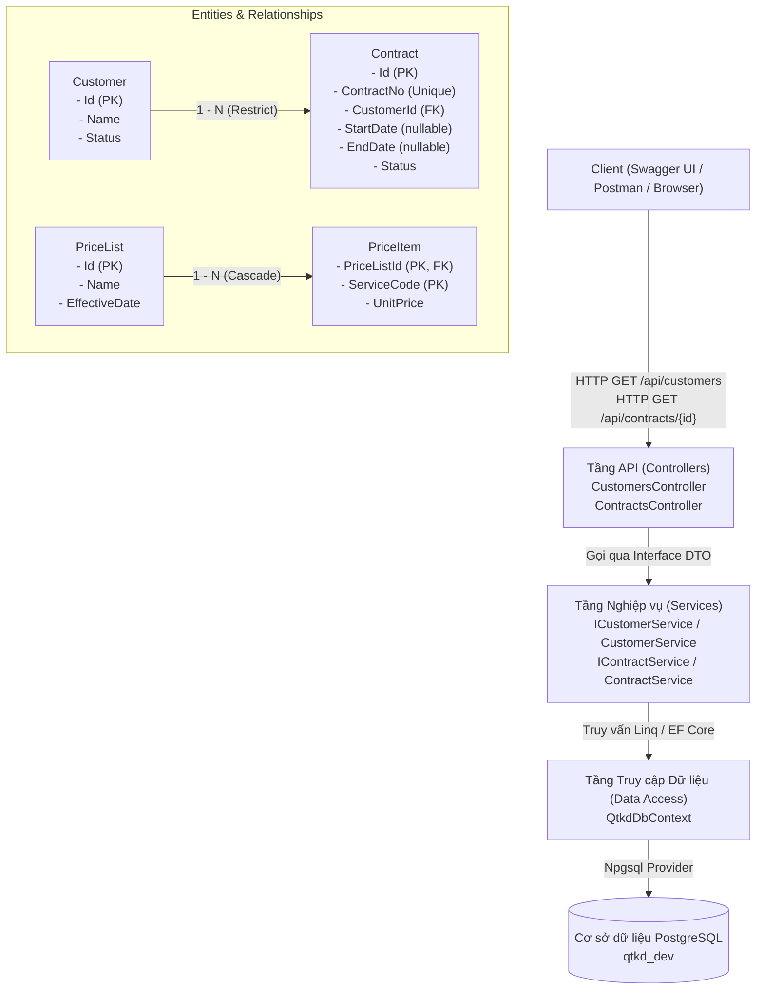

# KIẾN TRÚC HỆ THỐNG QTKD (PHASE 2 - TUẦN 05)

## 1. Sơ đồ các tầng kiến trúc (Solution Architecture)

## 2. Mô tả các thành phần chính
1. **API Layer (`src/QTKD.Api/Controllers`)**: Tiếp nhận request HTTP, điều hướng, trả về HTTP Status Code và DTO tương ứng.
2. **Business/Service Layer (`src/QTKD.Api/Services`)**: Đảm nhiệm xử lý nghiệp vụ, chuyển đổi Entity sang DTO để tránh lộ thực thể nội bộ và chống lỗi vòng lặp JSON (Object cycle). Sẵn sàng mở rộng cho các quy tắc CTR-01, CTR-02, CTR-03 ở Tuần 06.
3. **Data Access Layer (`src/QTKD.Api/Data`)**: Quản lý DbContext, ánh xạ Fluent API, thiết lập quan hệ bảng, chuyển đổi Enum sang chuỗi và quản lý seed data.
4. **Entities (`src/QTKD.Api/Entities`)**: Định nghĩa các thực thể cốt lõi theo thiết kế Phase 1 (`Customer`, `Contract`, `PriceList`, `PriceItem`).
5. **DTOs (`src/QTKD.Api/Dtos`)**: Định dạng dữ liệu truyền tải qua API (`CustomerDto`, `ContractDto`).
