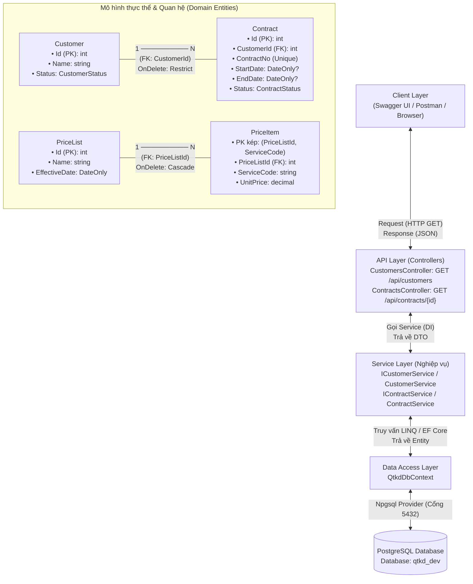

# KIẾN TRÚC HỆ THỐNG QTKD (PHASE 2 - TUẦN 05)

## 1. Sơ đồ các tầng kiến trúc (Solution Architecture)

## 2. Mô tả chi tiết các thành phần chính
1. **Client Layer**:
   * **Swagger UI** (`https://localhost:<port>/swagger`): Giao diện tương tác và kiểm thử API trực quan.
   * **Postman / Browser**: Các công cụ gửi request HTTP GET đọc dữ liệu.
2. **API Layer (`src/QTKD.Api/Controllers`)**:
   * `CustomersController`: Cung cấp endpoint `GET /api/customers`, tiêm phụ thuộc `ICustomerService`, trả về `List<CustomerDto>`.
   * `ContractsController`: Cung cấp endpoint `GET /api/contracts/{id}`, tiêm phụ thuộc `IContractService`, trả về `ContractDto` (hoặc 404 NotFound nếu không tìm thấy).
3. **Service Layer (`src/QTKD.Api/Services`)**:
   * `ICustomerService / CustomerService`: Tách biệt logic đọc danh sách khách hàng và ánh xạ sang DTO.
   * `IContractService / ContractService`: Tách biệt logic đọc chi tiết hợp đồng kèm thông tin khách hàng liên kết.
   * *Mục tiêu:* Đảm bảo phân tầng chuẩn theo đề bài, che giấu cấu trúc DB, tránh lỗi vòng lặp JSON và chuẩn bị sẵn sàng cho các rule CTR-01, CTR-02, CTR-03 ở Tuần 06.
4. **Data Access Layer (`src/QTKD.Api/Data`)**:
   * `QtkdDbContext`: Thiết lập cấu hình Fluent API, chuyển đổi Enum sang chuỗi (`HasConversion<string>()`), đánh `Unique Index` trên `ContractNo`, cấu hình hành vi xóa (`Contract → Customer: Restrict`, `PriceItem → PriceList: Cascade`).
   * Seed Data (`HasData`): Khởi tạo 2 Customer (`Công ty Minh Phát`, `Công ty Hải Long`), 1 Contract Draft (`HD-2026-018` thiếu ngày), 1 PriceList và 2 PriceItem.
   * Migration đã sinh: `20261124131958_InitialCreate.cs` chứa đầy đủ cấu trúc 4 bảng và dữ liệu mẫu seed data.
5. **Domain Entities (`src/QTKD.Api/Entities`)**:
   * Các thực thể: `Customer`, `Contract`, `PriceList`, `PriceItem`.
   * Các Enum: 
     * `CustomerStatus`: `Active`, `Inactive`.
     * `ContractStatus`: `Draft`, `PendingApproval`, `RevisionRequested`, `Approved`, `Rejected` (đầy đủ theo sơ đồ trạng thái Phase 1).
6. **PostgreSQL Database**:
   * Database: `qtkd_dev` (Port: 5432).
   * 4 Bảng vật lý:
     1. `Customers`: PK: `Id` | `Name`, `Status`.
     2. `Contracts`: PK: `Id` | FK: `CustomerId` | `ContractNo (Unique)`, `StartDate`, `EndDate`, `Status`.
     3. `PriceLists`: PK: `Id` | `Name`, `EffectiveDate`.
     4. `PriceItems`: PK kép: `(PriceListId, ServiceCode)` | FK: `PriceListId`, `UnitPrice`.
